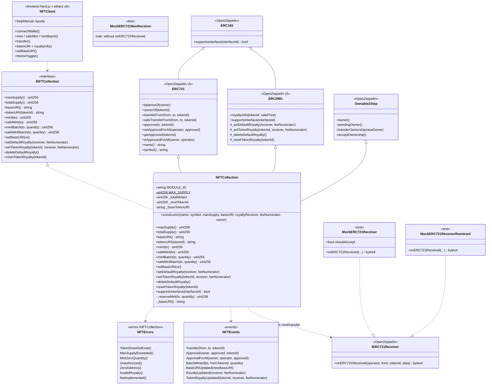

# Class Diagram — ERC-721 NFT Collection & Royalty

> 🌐 **English** · [Español](./01-diagrama-clases-ES.md)

**As-built** view (Phase 7) aligned with `src/NFTCollection.sol` + `INFTCollection.sol` + `frontend/` demo.

---

## 1. Class diagram (Mermaid)



---

## 2. Responsibilities

| Type | Responsibility |
|------|-----------------|
| `INFTCollection` | Stable public surface (tests, scripts, UI) |
| `NFTCollection` | Mint/batch, URI, royalties, supply cap, admin |
| OZ `ERC721` | Ownership, transfers, approvals, safe receiver |
| OZ `ERC2981` | `royaltyInfo` + default/per-token storage |
| OZ `Ownable2Step` | Admin URI / royalty / 2-step ownership |
| `IERC721Receiver` | Hook on contract recipients (safe paths) |
| Mocks | Acceptance, rejection and reentrancy in tests |
| `NFTClient` | Phase 6–7 demo (`frontend/`, theme + help) |

---

## 3. Critical state (as-built)

```text
Global (NFTCollection):
  MODULE_ID               // constant "04-erc721"
  MAX_SUPPLY              // immutable
  _totalMinted            // totalSupply()
  _nextTokenId            // next id (starts at 0)
  _baseTokenURI           // dynamic root

Per token (OZ ERC721):
  _owners[tokenId]
  _tokenApprovals[tokenId]

Per owner/operator:
  _balances[owner]
  _operatorApprovals[owner][operator]

Royalties (OZ ERC2981):
  default royalty receiver + feeNumerator
  per-tokenId royalty (optional)
```

### `tokenURI` policy (frozen)

```text
_requireOwned(tokenId)   // if it does not exist → OZ error / TokenDoesNotExist via tests
base = _baseTokenURI
bytes(base).length > 0 ? concat(base, tokenId.toString()) : ""
```

Off-chain convention: end `baseURI` with `/` if the host requires it.

---

## 4. Verified interface IDs

| Standard | Interface ID |
|----------|----------------|
| ERC-165 | `0x01ffc9a7` |
| ERC-721 | `0x80ac58cd` |
| ERC-721 Metadata | `0x5b5e139f` |
| ERC-2981 | `0x2a55205a` |

---

## 5. Solidity layout (implemented)

1. SPDX + `pragma solidity 0.8.24;`
2. OZ imports + `INFTCollection`
3. Contract: inherits `INFTCollection, ERC721, ERC2981, Ownable2Step`
4. State (`MAX_SUPPLY`, `_totalMinted`, `_nextTokenId`, `_baseTokenURI`)
5. Constructor
6. Views → mint mutators → admin URI/royalty → `_reserveMint` / `_baseURI` / `supportsInterface`

---

## 6. Design decisions (v1 closed)

| Topic | Decision |
|------|----------|
| Base | OpenZeppelin ERC721 + ERC2981 |
| `tokenId` | Sequential from **0** |
| Mint | **onlyOwner** |
| `mint` / `safeMint` | Both + batch variants |
| Per-token royalty | Yes (`set` / `reset`) + default |
| Pausable / Enumerable / URIStorage | No |
| Reveal / allowlist | Out of scope |
