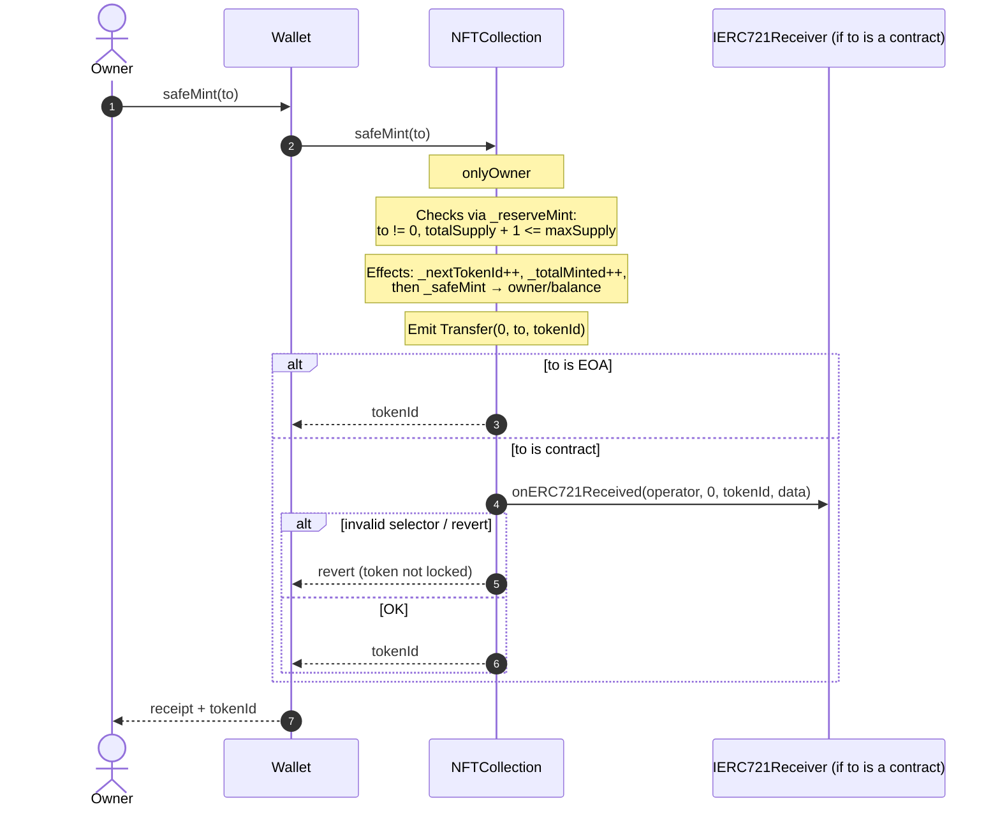
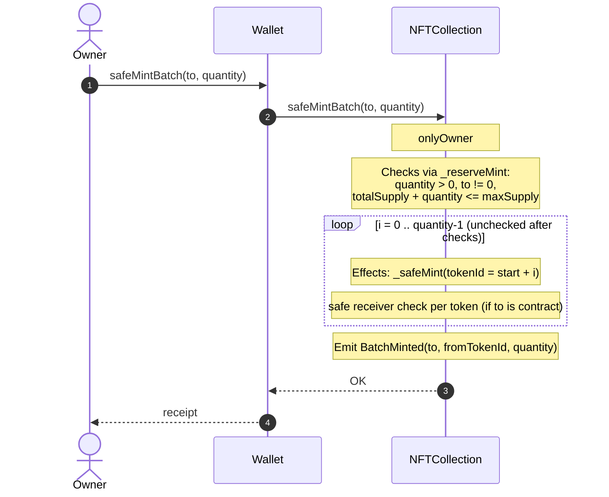
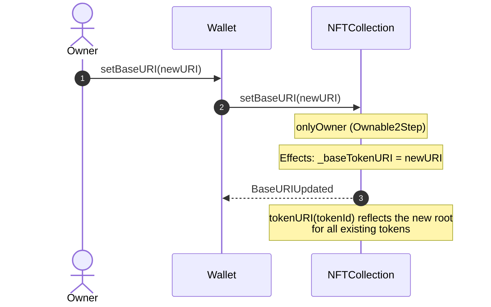
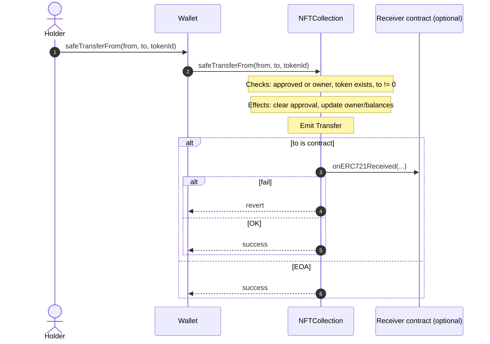
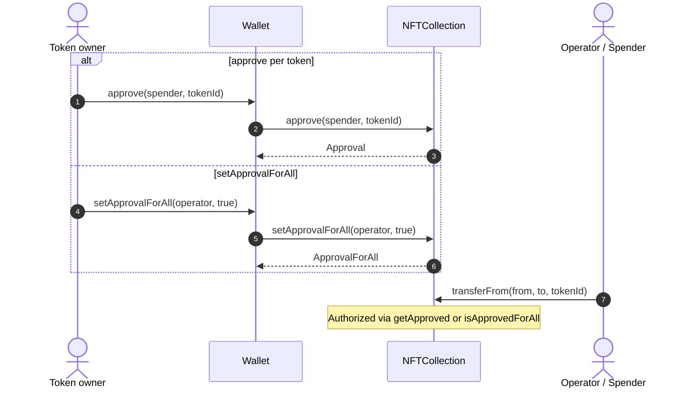
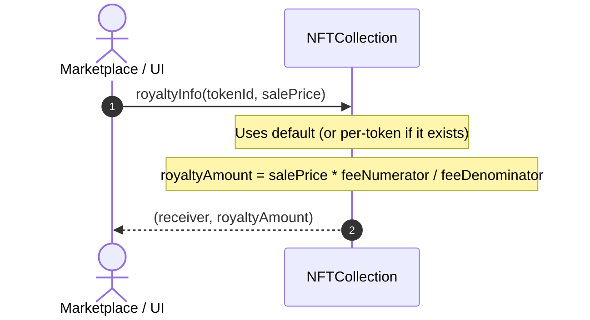
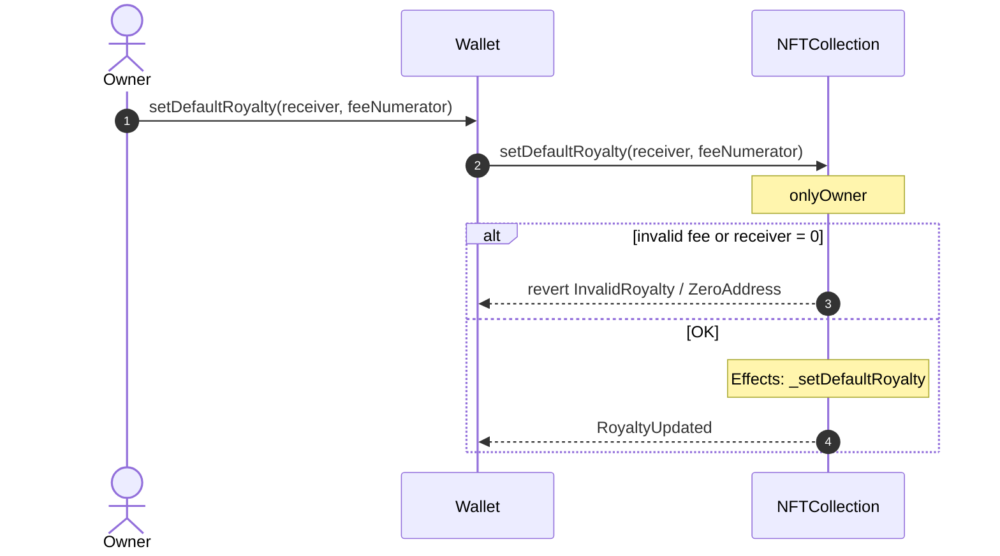
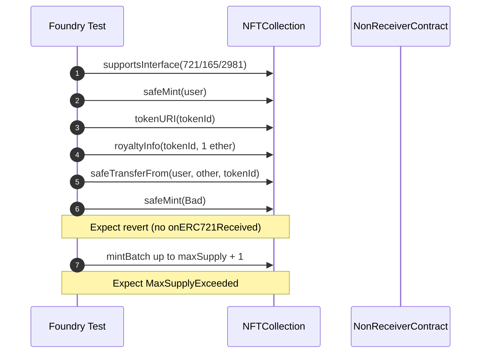
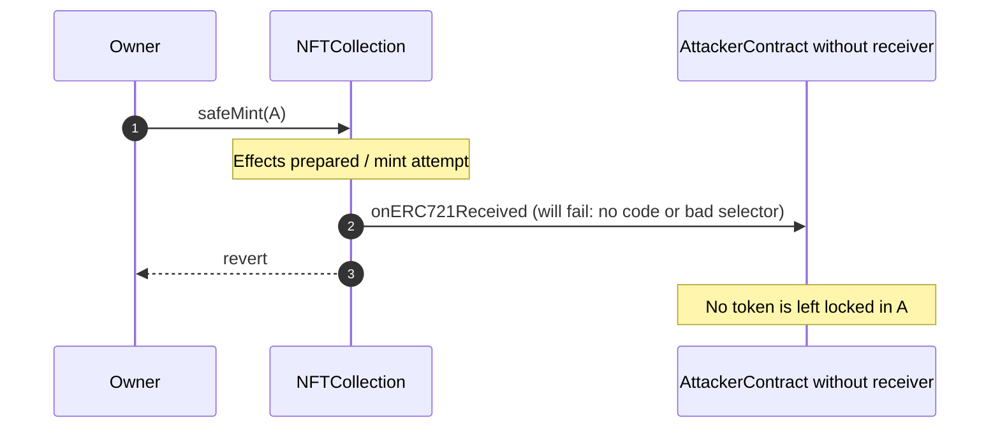

# Flow Diagram — ERC-721 NFT Collection & Royalty

> 🌐 **English** · [Español](./02-diagrama-flujo-ES.md)

**As-built** sequences (Phase 7): owner/user ↔ wallet/frontend ↔ `NFTCollection`.  
Complements: [`03-flujograma-EN.md`](./03-flujograma-EN.md) · plan: [`00-plan-implementacion-EN.md`](./00-plan-implementacion-EN.md).

---

## 1. Single mint (`safeMint`)



---

## 2. Batch mint (`safeMintBatch`)



---

## 3. Base URI update



---

## 4. Safe transfer between users



---

## 5. Approvals



---

## 6. Royalty query (ERC-2981)



---

## 7. Royalty configuration (admin)



---

## 8. 2-step ownership (Ownable2Step)

```mermaid
sequenceDiagram
    autonumber
    actor O as Current owner
    actor P as New owner
    participant N as NFTCollection

    O->>N: transferOwnership(P)
    Note over N: pendingOwner = P
    P->>N: acceptOwnership()
    Note over N: owner = P; pending cleared
    Note over O,P: Only the accepted owner can setBaseURI / royalties / mint
```

---

## 9. Test lifecycle (mint → URI → transfer → royalty → interface)



---

## 10. Safe mint to a malicious / hookless contract (must fail)


