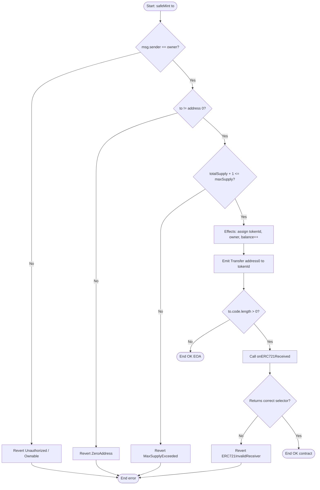
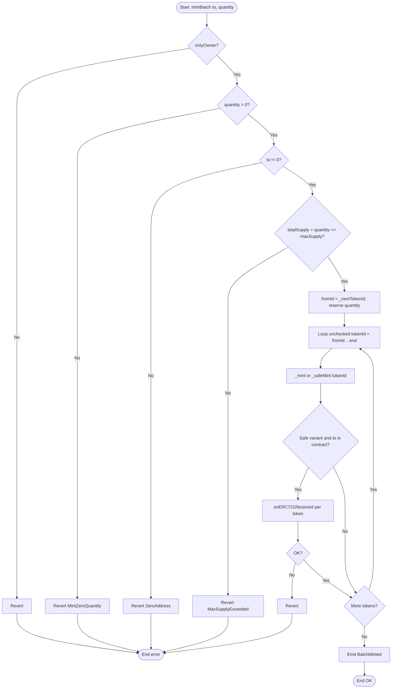
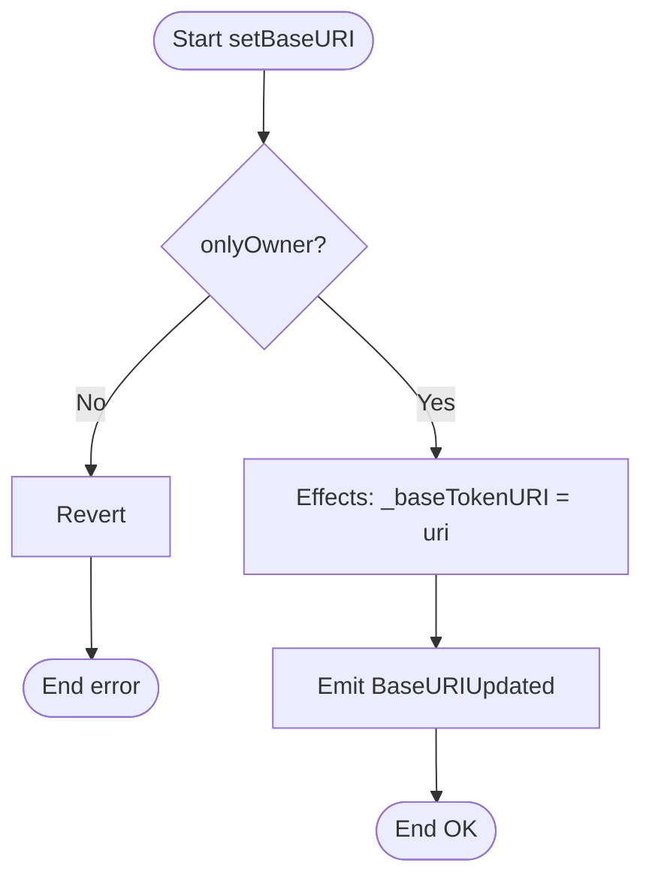
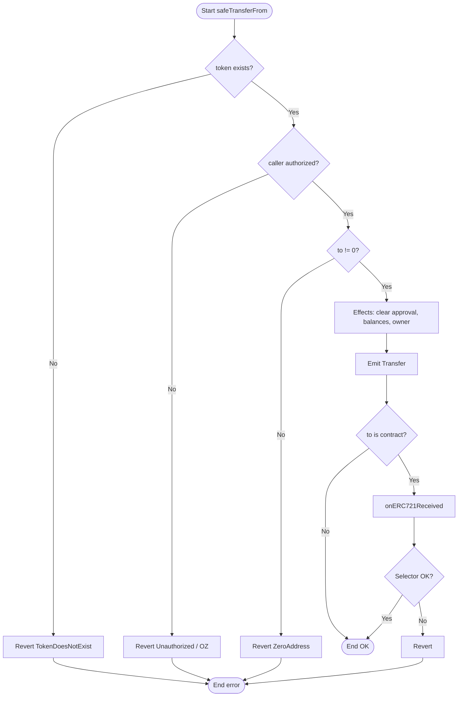
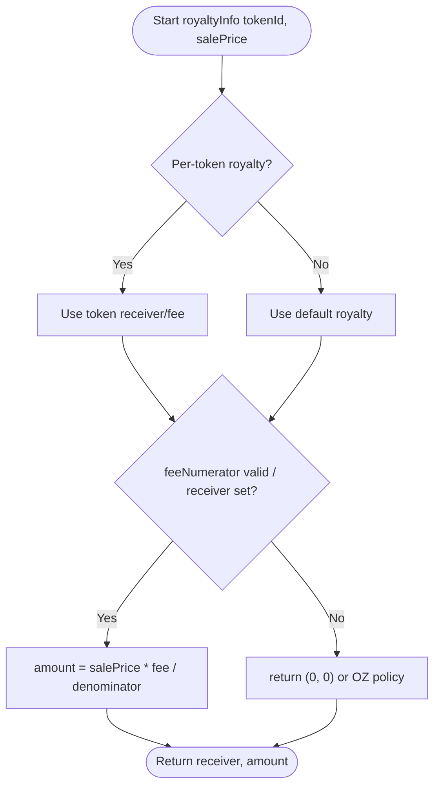
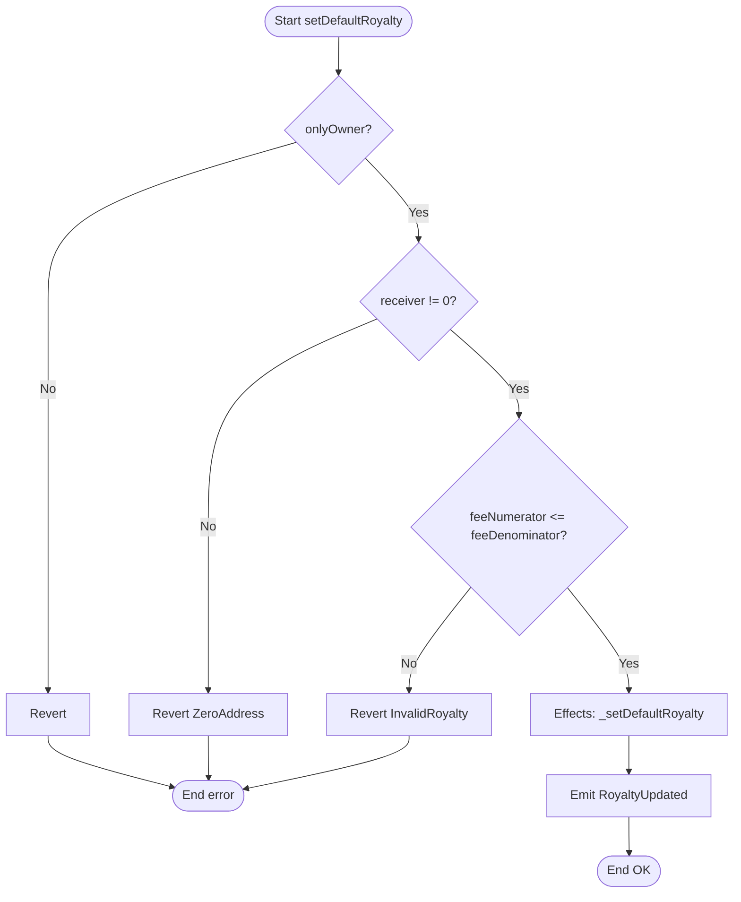
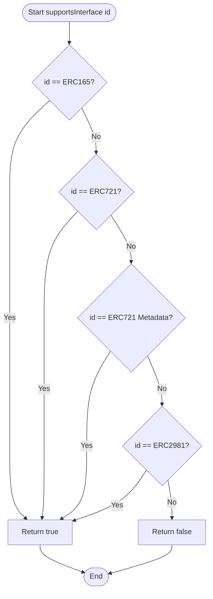
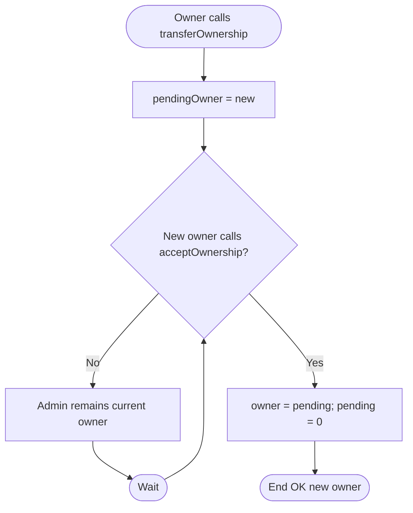
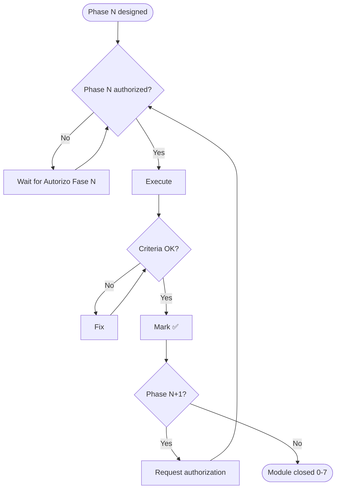

# Flowchart — ERC-721 NFT Collection & Royalty

> 🌐 **English** · [Español](./03-flujograma-ES.md)

**As-built** decision diagrams (Phase 7). Sequences: [`02-diagrama-flujo-EN.md`](./02-diagrama-flujo-EN.md). Plan: [`00-plan-implementacion-EN.md`](./00-plan-implementacion-EN.md).

Mint order: `onlyOwner` → `_reserveMint` (checks + id reservation) → effects `_mint`/`_safeMint` → (safe) receiver interaction.

---

## 1. Flowchart: `safeMint(to)`



---

## 2. Flowchart: `mintBatch` / `safeMintBatch`



> Note: `_reserveMint` updates `_nextTokenId` and `_totalMinted` **before** the mint loop.

---

## 3. Flowchart: `tokenURI(tokenId)`

```mermaid
flowchart TD
    A([Start tokenURI]) --> B{token exists? _requireOwned}
    B -->|No| C[Revert OZ / TokenDoesNotExist]
    C --> Z([End error])
    B -->|Yes| D[Read _baseTokenURI]
    D --> E{bytes base length > 0?}
    E -->|No| F["return \"\" (OZ policy)"]
    E -->|Yes| G["return concat(baseURI, tokenId)"]
    F --> H([End OK])
    G --> H
```

---

## 4. Flowchart: `setBaseURI`



---

## 5. Flowchart: `safeTransferFrom`



---

## 6. Flowchart: `royaltyInfo`



---

## 7. Flowchart: `setDefaultRoyalty`



---

## 8. Flowchart: `supportsInterface`



---

## 9. Flowchart: Ownable2Step (owner change)



---

## 10. Flowchart: module phase authorization



---

## 11. Quick legend

| Symbol | Meaning |
|---------|-------------|
| Oval | Start / end |
| Rectangle | Process or effect |
| Diamond | Decision |
| CEI | Checks → Effects → Interactions (where there are external calls) |
| Safe path | Requires `onERC721Received` if `to` is a contract |
| Batch guard | Validate supply/quantity **before** the `unchecked` loop |
| Ownable2Step | Admin only after `acceptOwnership` |
