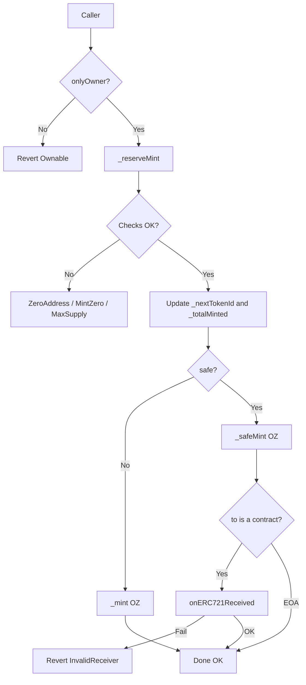

# Technical Decisions, Logic and Gas — NFTCollection
> 🌐 **English** · [Español](./DECISIONES-TECNICAS-ES.md)

This document explains **what was decided**, **how the logic flows**, and **where gas could still be saved**.  
Complements: [`GAS-EN.md`](./GAS-EN.md) · [`SWC-AUDIT-EN.md`](./SWC-AUDIT-EN.md) · [`LIMITACIONES-EN.md`](./LIMITACIONES-EN.md) · [`MEJORAS-EN.md`](./MEJORAS-EN.md).

Contract: `src/NFTCollection.sol`  
Interface: `src/interfaces/INFTCollection.sol`

---

## 1. Technical decisions (v1)

### 1.1 Stack and standards

| Decision | Choice | Rationale |
|----------|--------|-----------|
| Compiler | `pragma solidity 0.8.24` (fixed) | No floating pragma (SWC-103); native overflow checks |
| ERC-721 / 2981 base | OpenZeppelin v5 | Audited security, `supportsInterface`, safe receiver |
| Admin access | `Ownable2Step` | Two-step ownership change (lower risk of accidental transfer) |
| Tooling | Foundry | Unit + fuzz + invariant + gas report |
| Demo UI | Next.js 15 + ethers v6 | Demonstrate mint/transfer/URI/royalty outside the contract |

### 1.2 Product model

| Decision | Choice | Rationale |
|----------|--------|-----------|
| Who mints | **Owner only** | Curated collection; no public mint or allowlist in v1 |
| Numbering | `tokenId` starting at **0** | Simple sequential; `_nextTokenId` starts at 0 |
| Metadata | Single `baseURI` + concatenated id | Cheap on-chain; no per-token URIStorage |
| Royalties | ERC-2981 default + per-token override | Marketplaces read `royaltyInfo` |
| Pausable / Enumerable | **No** | Smaller attack surface and less storage gas |
| Upgradeable | **No** | Simple trust model; no proxy |

### 1.3 Security vs ergonomics

| Decision | Choice | Rationale |
|----------|--------|-----------|
| Errors | Custom errors in the interface | Cheaper reverts vs `require("…")` |
| "Hard" mint vs safe | Both APIs (`mint` / `safeMint` + batch) | Flexibility for EOAs vs contracts; lock risk documented |
| Supply | Check **before** the loop | Fail-fast; enables a safe `unchecked` loop |
| Sensitive admin | `onlyOwner` only | URI, royalties and mint under the same authority |

### 1.4 Explicit (accepted) tradeoffs

1. **OZ vs from-scratch:** more bytecode / deploy cost (~1.7M gas, ~8.8 KB), in exchange for mature ERC-721/2981 code paths.
2. **O(n) batch:** functionally required; gas grows linearly with `quantity` (bounded by `maxSupply`).
3. **`safeMint` costs more:** the `onERC721Received` check costs ~tens of k gas; you pay for safety (no locked tokens).
4. **Two counters** (`_totalMinted` + `_nextTokenId`): in v1, without burn, they are redundant in value, but they keep the "minted supply" vs "next id" semantics clear should burns ever be added.

---

## 2. Contract logic

### 2.1 State

```text
MAX_SUPPLY      immutable     mint ceiling
_totalMinted                  how many have been minted (totalSupply)
_nextTokenId                  next id to assign (0, 1, 2, …)
_baseTokenURI                 metadata root
(+ OZ storage: owners, balances, approvals, royalties)
```

### 2.2 Mint flow (core)

Every mint path follows the same pattern:

```text
onlyOwner
    → _reserveMint(to, quantity)
         1. to ≠ 0
         2. quantity > 0
         3. _totalMinted + quantity ≤ MAX_SUPPLY
         4. firstId = _nextTokenId
         5. unchecked: _nextTokenId += q ; _totalMinted += q
    → for each id: _mint / _safeMint (OZ)
    → (batch) emit BatchMinted
```

| Function | After reserving |
|----------|-----------------|
| `mint` | `_mint(to, id)` — no callback |
| `safeMint` | `_safeMint` — if `to` is a contract, requires `onERC721Received` |
| `mintBatch` | `_mint` loop |
| `safeMintBatch` | `_safeMint` loop (all-or-nothing if a receiver fails) |

**Mental model (CEI on safe paths):** OZ updates ownership/balances **before** calling the receiver; that is why the reentrancy tests cannot drain supply.

### 2.3 Metadata

```text
tokenURI(id) =
  token exists?
    yes → baseURI empty ? "" : concat(baseURI, id)
    no  → revert (OZ _requireOwned)
```

- `setBaseURI` (owner) changes the root for **all** existing tokens.
- Off-chain convention: end `baseURI` with `/` if the host requires it.

### 2.4 Royalties (ERC-2981)

```text
royaltyInfo(tokenId, salePrice)
  → per-token override if it exists
  → otherwise, default from constructor / setDefaultRoyalty
  → amount = salePrice * feeNumerator / 10000
```

Admin (owner): `setDefaultRoyalty`, `setTokenRoyalty`, `deleteDefaultRoyalty`, `resetTokenRoyalty`.

### 2.5 Transfers and ownership

- Transfers: standard OZ API (`transferFrom` / `safeTransferFrom` / approvals).
- Contract admin: `transferOwnership` → `acceptOwnership` (2 steps).

### 2.6 Summary diagram



---

## 3. Can the existing gas usage be improved?

**Yes**, with caveats: v1 already applies the "cheap and safe" optimizations. What remains are **tradeoffs** (less clarity, fewer OZ features, or more risk).

### 3.1 Already applied (not debt)

| Technique | Effect |
|-----------|--------|
| `immutable MAX_SUPPLY` | Avoids an expensive SLOAD on every mint |
| Checks in `_reserveMint` + `unchecked` loop | Less gas per iteration in batches |
| Custom errors | Cheaper reverts |
| No Enumerable / URIStorage / Pausable | Less storage and bytecode |
| Lean views | Cheap `royaltyInfo` / `supportsInterface` |

Baseline: [`GAS-EN.md`](./GAS-EN.md).

### 3.2 Possible improvements (estimated impact)

| Improvement | Potential savings | Cost / risk |
|-------------|-------------------|-------------|
| **ERC721A / ERC721C-style** (packed ownership, native batch mint) | High on batch mint | Replace the OZ base; re-audit; different attack surface |
| **Merge `_totalMinted` and `_nextTokenId`** (no burn) | Low (~1 fewer SSTORE per mint) | Semantics lost if burn is added later |
| **Pack royalty + flags** (custom storage packing) | Medium on admin/deploy | Drop OZ ERC2981 or fork it |
| **Cap `quantity` in batches** (e.g. max 20) | Does not lower per-unit gas; prevents giant txs | Product limitation |
| **Solmate / minimal ERC-721 implementation** | High on deploy + transfer | Lose battle-tested OZ; more responsibility |
| **`calldata` already used in `setBaseURI`** | Done | — |
| **Remove custom events** (`BatchMinted`, etc.) | Low | Worse off-chain indexing |
| **Proxy + implementations** | Cheaper instance deployment | Upgradeable model; not v1 |
| **"Lazy" mint / off-chain claim** | Very high on-chain | Different product design |

### 3.3 What **not** to "optimize" blindly

1. **Removing `safeMint*`:** saves gas, but increases tokens locked in contracts.
2. **`unchecked` without prior bounds:** minimal savings, overflow risk (SWC-101).
3. **Skipping `onlyOwner` / looser AccessControl:** this is not gas, it is security.
4. **Enumerable "because OpenSea":** most platforms index off-chain today; on-chain enumeration hurts on every mint/transfer.

### 3.4 Rule of thumb

> Optimize the **hot path** (mint/transfer), measuring with `forge test --gas-report`.  
> Do not rewrite OZ just for gas vanity unless there is a clear product goal (e.g. a 10k drop with huge batches → evaluate ERC721A).

---

## 4. How to read the code, in order

1. `INFTCollection.sol` — surface and URI/royalty rules.  
2. Constructor + state in `NFTCollection.sol`.  
3. `_reserveMint` — the heart of supply management.  
4. `mint*` / `safeMint*` — wrappers.  
5. URI / royalty admin.  
6. Tests: `test/unit/` (happy path), `test/attack/` (the attack must fail), `test/fuzz/` + `invariant/`.

---

## 5. One-sentence summary

**Decision:** a curated ERC-721 collection + 2981 royalties on top of OZ, with bounded supply and gas-conscious mint/batch.  
**Logic:** validate → reserve ids → mint (optionally safe) → URI/royalty admin restricted to the owner.  
**Gas:** already reasonably optimized for OZ; the next serious leap requires **switching the base** (e.g. ERC721A) or **reducing features**, not isolated micro-tweaks.
