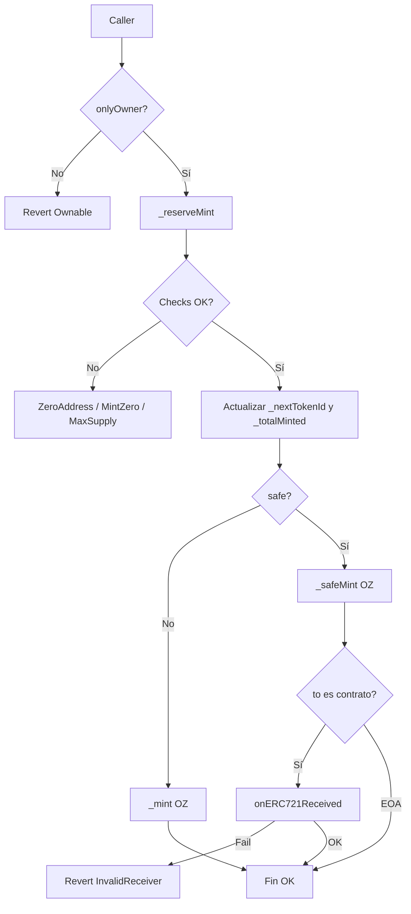

# Decisiones técnicas, lógica y gas — NFTCollection

> 🌐 [English](./DECISIONES-TECNICAS-EN.md) · **Español**

Documento para entender **qué se decidió**, **cómo fluye la lógica** y **dónde aún se podría ahorrar gas**.  
Complementa: [`GAS-ES.md`](./GAS-ES.md) · [`SWC-AUDIT-ES.md`](./SWC-AUDIT-ES.md) · [`LIMITACIONES-ES.md`](./LIMITACIONES-ES.md) · [`MEJORAS-ES.md`](./MEJORAS-ES.md).

Contrato: `src/NFTCollection.sol`  
Interfaz: `src/interfaces/INFTCollection.sol`

---

## 1. Decisiones técnicas (v1)

### 1.1 Stack y estándares

| Decisión | Elección | Motivo |
|----------|----------|--------|
| Compilador | `pragma solidity 0.8.24` (fijo) | Sin floating pragma (SWC-103); overflow checks nativos |
| Base ERC-721 / 2981 | OpenZeppelin v5 | Seguridad auditada, `supportsInterface`, safe receiver |
| Acceso admin | `Ownable2Step` | Cambio de owner en 2 pasos (menos riesgo de transfer accidental) |
| Tooling | Foundry | Unit + fuzz + invariant + gas report |
| UI demo | Next.js 15 + ethers v6 | Demostrar mint/transfer/URI/royalty fuera del contrato |

### 1.2 Modelo de producto

| Decisión | Elección | Motivo |
|----------|----------|--------|
| Quién mintea | **Solo owner** | Colección curada; sin mint público ni allowlist en v1 |
| Numeración | `tokenId` desde **0** | Secuencial simple; `_nextTokenId` inicia en 0 |
| Metadata | Una `baseURI` + concat id | Barato on-chain; sin URIStorage por token |
| Royalties | ERC-2981 default + override por token | Marketplaces leen `royaltyInfo` |
| Pausable / Enumerable | **No** | Menos superficie y menos gas de storage |
| Upgradeable | **No** | Modelo de confianza simple; no proxy |

### 1.3 Seguridad vs ergonomía

| Decisión | Elección | Motivo |
|----------|----------|--------|
| Errores | Custom errors en interfaz | Reverts baratos vs `require("…")` |
| Mint “duro” vs safe | Ambas APIs (`mint` / `safeMint` + batch) | Flexibilidad EOA vs contratos; documentar riesgo de lock |
| Supply | Check **antes** del loop | Fail-fast; permite `unchecked` seguro en el loop |
| Admin sensible | Solo `onlyOwner` | URI, royalties, mint bajo la misma autoridad |

### 1.4 Tradeoffs explícitos (aceptados)

1. **OZ vs from-scratch:** más bytecode / deploy (~1.7M gas, ~8.8 KB), a cambio de rutas ERC-721/2981 maduras.
2. **Batch O(n):** necesario funcionalmente; el gas crece lineal con `quantity` (acotado por `maxSupply`).
3. **`safeMint` cuesta más:** el chequeo `onERC721Received` vale ~decenas de k gas; se paga seguridad (no tokens locked).
4. **Dos contadores** (`_totalMinted` + `_nextTokenId`): en v1 sin burn son redundantes en valor, pero dejan clara la semántica “supply minteado” vs “siguiente id” si algún día hubiera burns.

---

## 2. Lógica que sigue el contrato

### 2.1 Estado

```text
MAX_SUPPLY      immutable     techo de mint
_totalMinted                  cuántos se mintearon (totalSupply)
_nextTokenId                  próximo id a asignar (0, 1, 2, …)
_baseTokenURI                 raíz de metadata
(+ storage OZ: owners, balances, approvals, royalties)
```

### 2.2 Flujo de mint (núcleo)

Todas las rutas de mint pasan por el mismo patrón:

```text
onlyOwner
    → _reserveMint(to, quantity)
         1. to ≠ 0
         2. quantity > 0
         3. _totalMinted + quantity ≤ MAX_SUPPLY
         4. firstId = _nextTokenId
         5. unchecked: _nextTokenId += q ; _totalMinted += q
    → por cada id: _mint / _safeMint (OZ)
    → (batch) emit BatchMinted
```

| Función | Tras reservar |
|---------|----------------|
| `mint` | `_mint(to, id)` — sin callback |
| `safeMint` | `_safeMint` — si `to` es contrato, exige `onERC721Received` |
| `mintBatch` | loop `_mint` |
| `safeMintBatch` | loop `_safeMint` (todo-o-nada si un receiver falla) |

**Orden mental (CEI en rutas safe):** OZ actualiza ownership/balances **antes** de llamar al receiver; por eso los tests de reentrancy no logran drenar supply.

### 2.3 Metadata

```text
tokenURI(id) =
  token existe?
    sí → baseURI vacío ? "" : concat(baseURI, id)
    no → revert (OZ _requireOwned)
```

- `setBaseURI` (owner) cambia la raíz para **todos** los tokens existentes.
- Convención off-chain: terminar `baseURI` en `/` si el host lo necesita.

### 2.4 Royalties (ERC-2981)

```text
royaltyInfo(tokenId, salePrice)
  → override per-token si existe
  → si no, default del constructor / setDefaultRoyalty
  → amount = salePrice * feeNumerator / 10000
```

Admin (owner): `setDefaultRoyalty`, `setTokenRoyalty`, `deleteDefaultRoyalty`, `resetTokenRoyalty`.

### 2.5 Transferencias y ownership

- Transfers: API estándar OZ (`transferFrom` / `safeTransferFrom` / approvals).
- Admin del contrato: `transferOwnership` → `acceptOwnership` (2 pasos).

### 2.6 Diagrama resumido



---

## 3. ¿Se puede mejorar el gas de lo que existe?

**Sí**, con matices: v1 ya aplica las optimizaciones “baratas y seguras”. Lo que queda son **tradeoffs** (menos claridad, menos features OZ, o más riesgo).

### 3.1 Ya aplicado (no es deuda)

| Técnica | Efecto |
|---------|--------|
| `immutable MAX_SUPPLY` | Evita SLOAD caro en cada mint |
| Checks en `_reserveMint` + loop `unchecked` | Menos gas por iteración en batch |
| Custom errors | Reverts más baratos |
| Sin Enumerable / URIStorage / Pausable | Menos storage y bytecode |
| Views delgadas | `royaltyInfo` / `supportsInterface` baratos |

Baseline: [`GAS-ES.md`](./GAS-ES.md).

### 3.2 Mejoras posibles (impacto estimado)

| Mejora | Ahorro potencial | Coste / riesgo |
|--------|------------------|----------------|
| **ERC721A / ERC721C-style** (ownership packed, batch mint nativo) | Alto en batch mint | Cambiar base OZ; re-auditar; otra superficie |
| **Unificar `_totalMinted` y `_nextTokenId`** (sin burn) | Bajo (~1 SSTORE menos por mint) | Pierdes semántica si agregas burn después |
| **Pack de royalty + flags** (storage packing propio) | Medio en admin/deploy | Dejar OZ ERC2981 o forkearlo |
| **Cap de `quantity` en batch** (p. ej. máx. 20) | No baja gas unitario; evita txs gigantes | Límite de producto |
| **Solmate / implementación mínima ERC-721** | Alto en deploy + transfer | Pierdes battle-tested OZ; más responsabilidad |
| **`calldata` ya usado en `setBaseURI`** | Hecho | — |
| **Quitar eventos custom** (`BatchMinted`, etc.) | Bajo | Peor indexación off-chain |
| **Proxy + implementaciones** | Deploy de instancias más barato | Modelo upgradeable; no es v1 |
| **Mint “lazy” / claim off-chain** | Muy alto on-chain | Otro diseño de producto |

### 3.3 Qué **no** conviene “optimizar” a ciegas

1. **Quitar `safeMint*`:** ahorra gas, aumenta tokens locked en contratos.
2. **`unchecked` sin bounds previos:** ahorro mínimo, riesgo overflow (SWC-101).
3. **Saltar `onlyOwner` / AccessControl más laxo:** no es gas, es seguridad.
4. **Enumerable “porque OpenSea”:** hoy la mayoría indexa off-chain; on-chain duele en cada mint/transfer.

### 3.4 Regla práctica

> Optimizar el **hot path** (mint/transfer) midiendo con `forge test --gas-report`.  
> No reescribir OZ solo por vanity de gas salvo un objetivo de producto claro (p. ej. drop de 10k con batches enormes → evaluar ERC721A).

---

## 4. Cómo leer el código en orden

1. `INFTCollection.sol` — superficie y reglas de URI/royalty.  
2. Constructor + estado en `NFTCollection.sol`.  
3. `_reserveMint` — corazón del supply.  
4. `mint*` / `safeMint*` — wrappers.  
5. Admin URI / royalty.  
6. Tests: `test/unit/` (feliz), `test/attack/` (debe fallar el ataque), `test/fuzz/` + `invariant/`.

---

## 5. Resumen en una frase

**Decisión:** colección curada ERC-721 + royalties 2981 sobre OZ, con supply acotado y mint/batch gas-conscientes.  
**Lógica:** validar → reservar ids → mintear (safe opcional) → admin URI/royalty solo owner.  
**Gas:** ya optimizado en lo razonable para OZ; el siguiente salto serio implica **cambiar de base** (p. ej. ERC721A) o **reducir features**, no micro-tweaks aislados.
